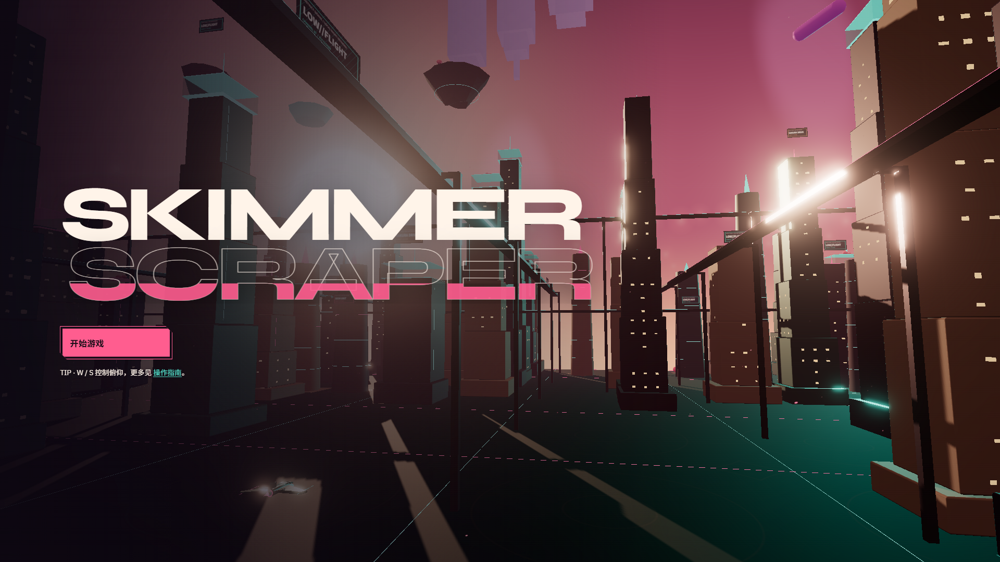
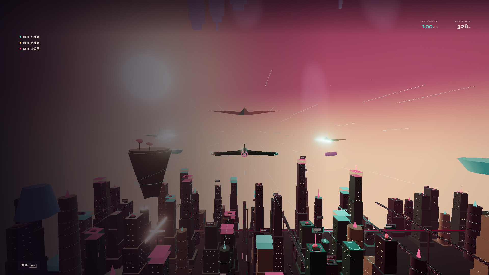

# Skimmer-Scraper

[](https://github.com/styayur/Skimmer-Scraper/actions/workflows/ci.yml)
[](https://github.com/styayur/Skimmer-Scraper)
[](LICENSE)

A close-surface flight game through a sakura-dusk city. Thread bridges, moving
structures and floating islands in Chase or Cockpit. New pilots take off in
shielded Free Flight with three local wingmates, Precision controls and a
wedge formation. Existing settings, aircraft, seeds and scores carry forward.

[Play on GitHub Pages](https://styayur.github.io/Skimmer-Scraper/)

Stable builds are deployed to Pages by a manual run from `main`. GitHub
Releases provides the verified build and its corresponding source.

The seeded city mixes tower canyons, stacked bridges and floating districts.
Static and animated GLB worlds can be imported from your device. Generate a
fresh layout or keep it with a single portable seed and the original GLB. A climb
through **520 m** can lead to the next sky, carrying the aircraft's bank and
camera into the dive. The distant mirrored skyline changes with each world.
Five arrivals reveal a light sculpture and signature. [World generation](docs/WORLD.md) · [World import](docs/WORLD-IMPORT.md) · [Moving structures](docs/DYNAMIC-WORLD.md)

Press **T** for text commands and replies. Each wingmate has a callsign and
role. Flight settings provide optional model cooperation and voice. When
voice input is enabled, hold **V** to speak and release to send. BYOK keys
live in page memory. The local controller works without an account or key.
DeepSeek voice sends only the opted-in audio or playback text and may incur
charges. [Companion radio](docs/RADIO.md) · [Voice setup and budgets](docs/VOICE.md)

Run `npm ci`, `npm run build`, and `npm run preview` to play locally. The
static ZIP runs on a static HTTP server. The build uses WebGL2 and contains
its source revision, licenses and credits. [Releases](https://github.com/styayur/Skimmer-Scraper/releases) · [Deployment](docs/DEPLOYMENT.md) · [Acceptance](docs/ACCEPTANCE.md)





## Challenge mode

- Stay within **32 m** of a solid surface to keep the **5 second** proximity grace full.
- Leaving every surface starts the countdown. Re-entering the band restores all five seconds.
- An impact ends the Challenge run. Shielded Free Flight absorbs contact and continues.
- Only survival time and a browser-local personal best are recorded.
- Press **R** at any time for instant retry.
- Import your own self-contained GLB aircraft; it stays in your browser's IndexedDB.
- Choose **Stable World** for reproducible seeds or **Ephemeral World** to let unloaded interiors
  change when you return.

## Controls

Open **游戏教程** from the title screen or press **H**. Search by control name,
topic or provider. In settings, **?** opens the matching chapter and closing the
tutorial returns to the same control. Use **复制种子** to copy a seed. Saved legacy
URLs still restore their original world parameters.

| Input | Action |
| --- | --- |
| W / S or Arrow Up / Down | Pitch down / up |
| A / D or Arrow Left / Right | Roll |
| Q / E | Yaw |
| Shift | Boost |
| C | Switch between Chase and Cockpit |
| R | Instant retry |
| Esc / gamepad Menu | Pause or close the current panel |
| F / G | Flight settings / world settings |
| M | Aircraft library |
| H | Searchable game tutorial, source and licenses |
| T | Companion text radio |
| V | Hold to record when voice input is enabled |
| Enter | Start |
| Gamepad D-pad or left stick | Move focus in menus |
| Gamepad A / B / View | Confirm / back / open game menu |

## Local GLB aircraft

Open the aircraft library and choose **导入本机 GLB**. The app validates the GLB, rejects external
resource URIs, stores the file in IndexedDB, and preserves authored materials while normalizing the
model to an 8 m envelope. Imported models can be rotated 180° or removed. No model bytes are uploaded.

Aircraft limits are 48 MB, 250,000 triangles and 24 stored models. World imports use their own
decoders and budgets. [Aircraft import](docs/MODELS.md) · [World import](docs/WORLD-IMPORT.md)

## Stack

- TypeScript, Three.js, Vite and `three-mesh-bvh`
- Vitest for pure simulation/rules/storage tests
- Playwright for real Chromium WebGL interaction and screenshots
- GitHub Pages static deployment workflow
- Web Audio synthesis for flight sound and opt-in streaming radio playback

## Architecture

```text
browser input -> FixedStepRunner (120 Hz)
                    |
                    v
              FlightModel.step()
                    |
                    v
             WorldStreamer.update()
       collision/render rings + prefetch
                    |
                    v
         ChunkedWorldAdapter.queryNearest()
           AABB chunks -> per-chunk MeshBVH
                    |
                    v
               RunRules.update()
                |           |
             HUD state   failure/best
                    |
                    v
     GameRenderer (WebGL2, render-local frame)
```

The flight model, run rules, spatial adapter, renderer, local model store and UI are separate modules.
Rendering never owns score state. See [docs/ARCHITECTURE.md](docs/ARCHITECTURE.md).

## Development

```powershell
npm install
npm run dev
```

Verification:

```powershell
npm run typecheck
npm test
npm run build
npm run test:e2e
```

Generate the synthetic GLB test fixture when changing the importer:

```powershell
npm run fixtures
```

## v0.1.0 acceptance

- Unit/integration tests: deterministic flight, fixed stepping, proximity rules, collision rules,
  BVH nearest-surface queries, local best, GLB validation, model normalization and IndexedDB storage.
- Browser tests: desktop/mobile title, WebGL2 flight, surface lock, grace expiry, impact, retry,
  local GLB import/persistence/rotation/removal, network privacy and WebGL2-unavailable fallback.
- Evidence: `acceptance/` and `evidence/`, including headless Chromium runtime details.
- The browser tests use SwiftShader in CI/headless mode. They are not a real-GPU performance
  certification. No real-GPU benchmark was performed for v0.1.0.

For v0.2.0, the headless proxy remains separate from a headed hardware benchmark. On Windows 11 with an
AMD Radeon 780M, Chrome 157, 1920 x 1080, both Balanced and High p95 frame times were below 33.3 ms.
See `evidence/v0.2.0-real-gpu.json` and [docs/ACCEPTANCE.md](docs/ACCEPTANCE.md).

Full matrix: [docs/ACCEPTANCE.md](docs/ACCEPTANCE.md).

## Research and licenses

Research notes cover Skyward, Neon Zenith and Sakura Fantasy in [docs/RESEARCH.md](docs/RESEARCH.md).
No code or assets from those projects are copied. Dependencies, fonts, research references and
original synthetic assets are documented in [CREDITS.md](CREDITS.md). New releases use AGPL-3.0-only. Historical v0.1.0/v0.2.0 remain MIT; their grants are not revoked. See licenses/PROJECT-MIT-v0.2.0.txt.

## v0.2.0 acceptance

- Vitest: 59 passed, 0 failed.
- Playwright: 10 passed, 0 failed, 0 skipped.
- Streaming: 15-minute deterministic flight, bounded chunks/BVHs, cancellation, floating origin and
  geometry-retirement evidence.
- Ephemeral World: Stable round trip reproducible; Ephemeral revisits change only after unload; history
  bounded to 256 entries.
- Frame-rate rules: equivalent 30/60/144 FPS outcomes for lock, impact and grace expiry.
- Real GPU: AMD Radeon 780M passed the Balanced and High p95 target at 1920 x 1080.
- Final machine-readable report: `acceptance/v0.2.0.json`.
- GitHub Pages production verification passed on 2026-11-09 for deployed commit `e56b034`.

## v0.2 phase status

| Phase | Status | Evidence |
| --- | --- | --- |
| Flight Experience | merged | `acceptance/v0.2/phase-1.json` |
| Seeded Procedural City | merged | `acceptance/v0.2/phase-2.json` |
| Infinite World Streaming | merged | `acceptance/v0.2/phase-3.json` |
| Ephemeral World | merged | `acceptance/v0.2/phase-4.json` |
| Final QA / v0.2.0 release | verified | `acceptance/v0.2.0.json` |

## v0.3 candidate

Challenge grace is configurable from 1 to 15 seconds (default 5). Free Flight has no proximity expiry and defaults to a shield. Options lock at takeoff; retry keeps the selection. Custom and assisted scores are separate; historical standard scores retain their keys.

Production deployment is now triggered by a stable version tag; merges and RC tags do not replace the public game. Source: https://github.com/styayur/Skimmer-Scraper. See docs/LICENSE-AUDIT.md.

Flight Settings includes a Classic profile and a Precision profile (speed-sensitive
control gain, full rolls/loops, optional coordinated turns and adjustable leveling).
Standard XInput gamepads support stick/trigger flight, Y view, X retry and Menu pause;
axis/button mappings, dead zone, response curve, sensitivity and inversion are editable.
Keyboard input takes priority while held. Esc pauses/resumes. The Free Flight shield
sweeps the collision sphere, reduces speed and reflects/slides along surfaces; disable
it before takeoff for ordinary impact failure. First-person aircraft anchors can be
saved per local model; both first-person views hide the aircraft mesh.

Choose 0–3 companions before takeoff. Local Autonomous Controller is entirely local:
independent steering/velocity, formation and independent follow, safe-route lead,
regroup, predictive obstacle/separation avoidance and contact recovery. Formation
(wedge, line, spread) and leader behavior can change while paused in Flight Settings.
The aircraft use one instanced mesh and reuse the player's streamed BVHs. Companion
challenge scores are assisted records; they never replace standard solo records.
