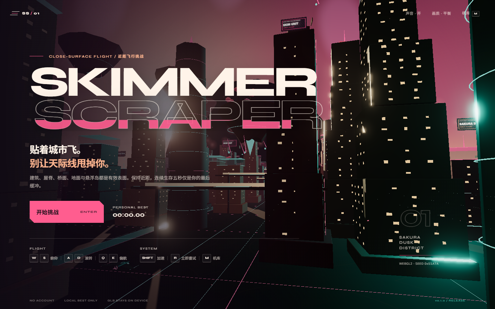
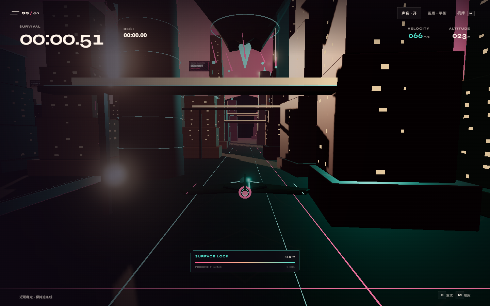

# Skimmer-Scraper

[](https://github.com/styayur/Skimmer-Scraper/actions/workflows/ci.yml)
[](https://github.com/styayur/Skimmer-Scraper)
[](LICENSE)

A close-surface 3D flight challenge through an original sakura-dusk megacity. Stay within reach of
the architecture, thread bridges and floating islands, and keep your run alive. No account, no remote
profile, no model upload.

**v0.2 development snapshot:** seeded cities, cockpit/chase views, dynamic proximity feedback,
on-demand world streaming and Stable/Ephemeral world modes are implemented. Final QA and the v0.2.0
release remain in the phase sequence; the public link follows `main` after each merged PR.

**Public preview:** [https://styayur.github.io/Skimmer-Scraper/](https://styayur.github.io/Skimmer-Scraper/)

The GitHub Pages preview is a playable static build. The requested Cloudflare Pages production
deployment is configured but currently blocked on Cloudflare credentials; see
[docs/DEPLOYMENT.md](docs/DEPLOYMENT.md). This distinction is deliberate and no Cloudflare deployment
success is claimed.





## The challenge

- Stay within **32 m** of a solid surface to keep the **5 second** proximity grace full.
- Leaving every surface starts the countdown. Re-entering the band restores all five seconds.
- Touching a building, roof, bridge, ground or floating island ends the run immediately.
- Only survival time and a browser-local personal best are recorded.
- Press **R** at any time for instant retry.
- Import your own self-contained GLB aircraft; it stays in your browser's IndexedDB.
- Choose **Stable World** for reproducible seeds or **Ephemeral World** to let unloaded interiors
  change when you return.

## Controls

| Input | Action |
| --- | --- |
| W / S or Arrow Up / Down | Pitch down / up |
| A / D or Arrow Left / Right | Roll |
| Q / E | Yaw |
| Shift | Boost |
| C | Chase / cockpit view |
| R | Instant retry |
| M | Aircraft library |
| Enter | Start |

## Local GLB aircraft

Open the aircraft library and choose **导入本机 GLB**. The app validates the GLB, rejects external
resource URIs, stores the file in IndexedDB, and preserves authored materials while normalizing the
model to an 8 m envelope. Imported models can be rotated 180° or removed. No model bytes are uploaded.

Limits: 48 MB, 250,000 triangles, 24 locally stored models. Draco/Meshopt-compressed GLBs require
extra decoders and are not currently supported. Full details: [docs/MODELS.md](docs/MODELS.md).

## Stack

- TypeScript, Three.js, Vite and `three-mesh-bvh`
- Vitest for pure simulation/rules/storage tests
- Playwright for real Chromium WebGL interaction and screenshots
- Cloudflare Pages and GitHub Pages static deployment workflows
- WebAudio synthesis for engine and wind sound; no audio downloads

## Architecture

```text
browser input -> FixedStepRunner (120 Hz)
                    |
                    v
              FlightModel.step()
                    |
                    v
             WorldStreamer.update()
       collision/render rings + prefetch
                    |
                    v
         ChunkedWorldAdapter.queryNearest()
           AABB chunks -> per-chunk MeshBVH
                    |
                    v
               RunRules.update()
                |           |
             HUD state   failure/best
                    |
                    v
     GameRenderer (WebGL2, render-local frame)
```

The flight model, run rules, spatial adapter, renderer, local model store and UI are separate modules.
Rendering never owns score state. See [docs/ARCHITECTURE.md](docs/ARCHITECTURE.md).

## Development

```powershell
npm install
npm run dev
```

Verification:

```powershell
npm run typecheck
npm test
npm run build
npm run test:e2e
```

Generate the synthetic GLB test fixture when changing the importer:

```powershell
npm run fixtures
```

## v0.1.0 acceptance

- Unit/integration tests: deterministic flight, fixed stepping, proximity rules, collision rules,
  BVH nearest-surface queries, local best, GLB validation, model normalization and IndexedDB storage.
- Browser tests: desktop/mobile title, WebGL2 flight, surface lock, grace expiry, impact, retry,
  local GLB import/persistence/rotation/removal, network privacy and WebGL2-unavailable fallback.
- Evidence: `acceptance/` and `evidence/`, including headless Chromium runtime details.
- The browser tests use SwiftShader in CI/headless mode. They are not a real-GPU performance
  certification. No real-GPU benchmark was performed for v0.1.0.

Full matrix: [docs/ACCEPTANCE.md](docs/ACCEPTANCE.md).

## Research and licenses

Research notes cover Skyward, Neon Zenith and Sakura Fantasy in [docs/RESEARCH.md](docs/RESEARCH.md).
No code or assets from those projects are copied. Dependencies, fonts, research references and
original synthetic assets are documented in [CREDITS.md](CREDITS.md). Project source is MIT licensed.

## v0.2 phase status

| Phase | Status | Evidence |
| --- | --- | --- |
| Flight Experience | merged | `acceptance/v0.2/phase-1.json` |
| Seeded Procedural City | merged | `acceptance/v0.2/phase-2.json` |
| Infinite World Streaming | merged | `acceptance/v0.2/phase-3.json` |
| Ephemeral World | in review | `acceptance/v0.2/phase-4.json` |
| Final QA / v0.2.0 release | planned | final PR |
