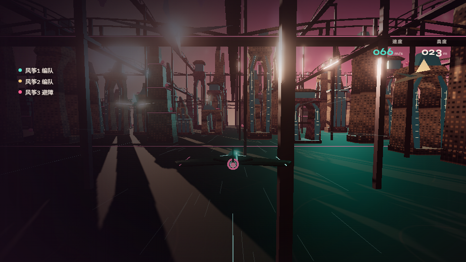

# Skimmer-Scraper · 掠面飞行

**Shift your flight. Shift your gravity. Shift your world.** 在樱色巨城贴着屋顶和墙面飞行，带领三台伴机穿过世界翻转。在稳定世界中可用种子重飞同一条航线。[在线游玩](https://styayur.github.io/Skimmer-Scraper/) · [Windows 下载](https://github.com/styayur/Skimmer-Scraper/releases/latest) · [English](README.md)

## 开始飞行

从有护盾的自由飞行开始。接近实体表面时按空格或手柄 LB 启用贴面机动，再按一次主动脱离。挑战模式为实际使用运动辅助的飞行保存独立成绩。按 **H** 打开游戏教程，**C** 切换视角，**Esc** 暂停，**Alt+Enter** 切换全屏。中文地区的浏览器显示简体中文，其余浏览器显示英文。

在机库选择原有战机、KITE-W 翼装或 KITE-S 微型飞行器。从世界面板进入樱色巨城、Dragonspine 或 WorldForge。短暂世界在街区卸载后可能改变布局，重现导入世界还需要原始 GLB。导入的本地 GLB 留在玩家设备上。Windows 可选装 Dragonspine 高精度资源包。[程序化世界](docs/WORLDFORGE.md) · [贴面物理](docs/SURFACE-GLIDE.md)

## 伴机与电台

按 **T** 打开电台，试试「风筝2护航」或「风筝1寻找通道」。三台伴机可以同时执行不同任务。文字指令、内置语音和程序化世界均可离线使用。在高级设置中可开启角色电台和背景音乐。可选云端服务使用玩家自己的密钥，费用由服务商收取。[伴机任务](docs/COMPANION-INTELLIGENCE.md) · [角色音频来源](docs/VOICE.md)



## Windows 与 itch.io

Windows x64 使用 WebView2，发行附件提供安装程序和便携版。安装程序未签 Authenticode。桌面设置可导出与恢复飞行员数据。itch.io 使用 HTML5 ZIP，解压后根目录含游戏入口和全部内置素材。[Windows 使用说明](docs/windows-desktop.md) · [参赛主题和 AI 使用披露](docs/GAME-OFF.md)

## 从源码运行

```sh
npm ci
npm run dev
```

运行 `npm run test:all` 执行类型检查、单元测试、生产构建和 Chromium 集成测试。桌面构建使用 Rust、Windows C++ 工具链及 `npm run desktop:build`。项目采用 AGPL-3.0-only，第三方代码、声音和工具保留各自的许可。[项目许可](LICENSE) · [来源与署名](CREDITS.md)
