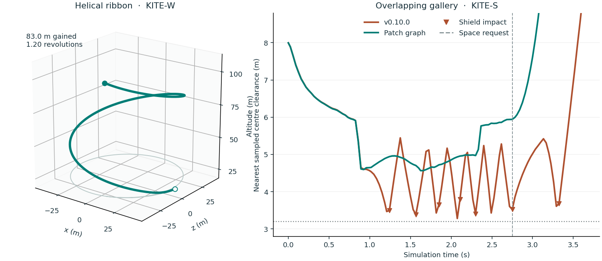
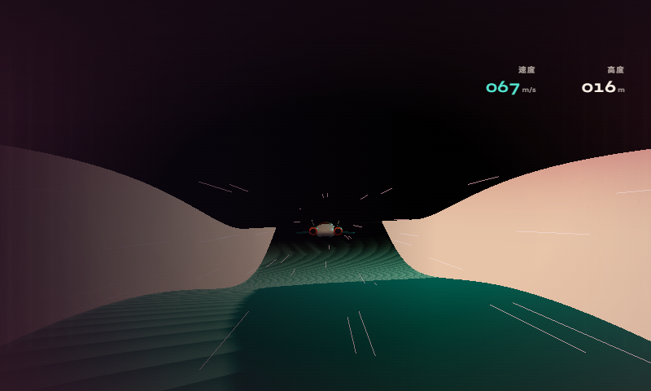
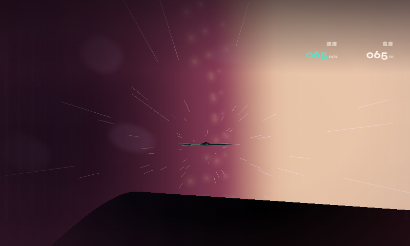

# Surface Glide 3.0 qualification

The standalone release correction at `38f4c3d8` qualifies the manual LB handoff on a descending ribbon. The original held-out impact, development boost comparisons, departure bounds and retained browser replays are recorded together. [Swept departure qualification](ribbon-departure/README.md)

The follow-up qualification covers the revision 2 ribbon-bridge regression on three frozen development inputs. Flight source `34e62ffc` restored continuous LB glide on all three. The original gallery, helix, gap, coplanar turns and dynamic crossings were replayed on that source. [First divergent contacts, controlled browser runs and retained fixtures](ribbon-recheck/README.md)

The strongest difference on the fixed assets was the curved gallery. Both aircraft on the candidate held the floor beneath a nearer ceiling, then detached on the second Space press. The reference lost the floor and hit the shield seven times. Both controllers completed the helical climb. [Issue 76](https://github.com/styayur/Skimmer-Scraper/issues/76)

## Imported-world gameplay

The reference was the clean v0.10.0 production build at `991138b8c67c188bd47731d6c193142750225818`. The candidate was the clean production build at `60e57676b4916fd5f83e6401bade92e832f3c29a`. Chromium 159.0.8154.6 used WebGL2 with SwiftShader on Windows. Each pair used the same GLB bytes, seed 334458, manual spawn, aircraft, camera, 66 m/s entry and keyboard events at the same physics ticks. The test imported each GLB through the world library, started with Enter and captured with Space. It aligned takeoff to an animation frame and sampled every 32 ms.

| Fixture and aircraft | Longest continuous glide, reference → candidate | Candidate result |
| --- | ---: | --- |
| Helical ribbon, KITE-W | 285.1 → 285.1 m | Climbed 83.0 m through 7.57 radians. Minimum sampled centre clearance was 6.03 m. |
| Curved gallery, KITE-S | 43.8 → 172.9 m | Zero contact losses or shield impacts. Minimum sampled centre clearance was 4.57 m. |
| Same gallery, procedural aircraft | 43.8 → 172.9 m | Matched the KITE-S trajectory under identical input. |
| Three-sheet lip and 34 m gap, procedural aircraft | 33.7 → 31.4 m | Reached free flight at 1.017 s, before the far deck. Zero shield impacts. |

The helix had one 23-tick Q input to introduce upward velocity. Space requested launch at tick 576 on the helix and tick 330 in the gallery. The gap had one Space capture and neutral controls thereafter. Browser acceleration is the velocity difference between samples. The reference gallery peak includes a shield response. Each paired JSON contains the inputs, GLB SHA-256, build metadata, phase transitions and position, velocity, speed, clearance, camera and shield samples. [Helix trace](browser-helix-kite-w.json) · [KITE-S gallery trace](browser-gallery-kite-s.json) · [Procedural gallery trace](browser-gallery-procedural.json) · [Gap trace](browser-gap-procedural.json)



The gallery plot enlarges the range around the dotted 3.2 m body radius. The trace includes the higher post-launch clearances.





## Fixed-step collision evidence

The deterministic fixtures call the flight model and glide controller at 120 Hz. Before each world motion step the fixture bisects the radius of the world's conservative swept chord test, to within 0.020 m, in covered collision space. After advancing moving colliders it runs the production Challenge and shield collision queries independently. `minSwept` is a lower bound on centre clearance along covered chords. Subtract the common 3.2 m aircraft radius for hull margin. `longest` includes verified transfer legs. `glideSeconds` and `glideDistance` count the GLIDING phase. [Paired fixed-step measurements](fixed-step.json)

| Fixture | Candidate observations |
| --- | --- |
| Helix and gallery at 48, 76 and 102 m/s, classic and precision controls | All twelve runs finished gliding. The lowest gallery swept clearance bound was 3.87 m at boost. |
| Mirrored narrow ribbons, 56 m/s | Both directions supported 82.9 m uninterrupted. The reference released after 24.8 m. |
| Oblique concave and convex folds across two chunk leases, 68 m/s | 135.3 m continuous including the convex transfer, 5.00 m minimum swept clearance, 254.2 m/s² peak. Reversing visit order and omitting logical IDs reproduced the flight. |
| Reloaded seam at 48, 76 and 102 m/s | Both leases supported the crossing in every run. The lowest swept bound was 5.56 m. |
| Translating carrier and a second panel that crosses early | Both runs retained carrier momentum for 107.7 m. |
| Occupied moving intersection | Recovery began at 0.542 s. At 0.642 s the neutral aircraft reached the panel during handoff. Both collision paths registered the impact. |
| Three-sheet lip at all three speeds, unavailable coverage, replaced mesh, intermittent lease | The controller released. The three-sheet lips had insufficient landing support. A repeated one-tick return of an intermittent mesh exhausted the coast budget. |

An early graph could defer steering until the final station and repeatedly project its planned centre back onto the side of a narrow ribbon. The aircraft continued straight and released after 15.4 m on both mirrored fixtures. Applying the lateral edge tolerance to all smooth facets then caused false releases on the 48 m/s helix. The accepted controller distinguishes lateral overhang on a coplanar edge from longitudinal contact at a faceted bend and gives earlier verified turns a lower cost.

## Controller and integration

LB or Space arms the existing two-second capture window. Every 15 Hz plan samples up to five stations of actual contact in the direction of relative travel. Two half-edges can resolve a rough fold within a station. At a lateral edge the graph keeps up to three initial steering choices and requires a full swept continuation to turn. A query near the previous contact plane can preserve the supporting floor through overlaps. Every proposed edge uses current collision coverage and timed sweeps. During execution the controller transports the tangent between live normals, applies the curvature speed limit with bounded acceleration and checks each new displacement. A failed path can coast for less than 6 m and 0.36 s. Intermittent contact shares that budget until two planning intervals of support have elapsed. The existing Challenge browser fixture checks that an attached run retains its Assisted score category after launch.

Kinetic City and the controller share one optional `SurfaceQuery.contact.logicalSurfaceId` field. The city owns the BVH-to-identity mapping. The controller checks live geometry incarnation, position, normal, velocity and clearance even when two keys match. An isolated run combined city source `1739f9b3e5178a014e279e171fc7ef366d7679d1` with the candidate flight sources. In 90 fixed ticks the north socket on seed 334458 passed from chunk `0:1` to `0:0` on `kinetic-grid-1-r2.334458.spine.0`. It finished GLIDING, with 6.137 m minimum sampled centre clearance and zero collisions or shield impacts. [Socket trace and replay parameters](kinetic-socket.json)

## Reproduction and scope

Build the candidate and run the controller and browser fixtures from its checkout.

```powershell
npm ci
npm run build
$env:SKIMMER_PATCH_REPORT = "$PWD/patch-matrix.json"
npm test -- tests/unit/surfacePatchGraph.test.ts tests/unit/surfaceTrajectory.test.ts tests/unit/surfaceGlide.test.ts
npm run test:e2e -- tests/e2e/surface-patch-glide.spec.ts tests/e2e/surface-glide-tower.spec.ts tests/e2e/glide-score.spec.ts
```

For the browser reference, serve the clean baseline build on a separate loopback port, set `SKIMMER_GLIDE_REFERENCE_URL` to its origin and rerun the same browser spec. It verifies the baseline build identity and records the observed outcome. For the fixed-step reference, copy the candidate's `tests/unit/surfacePatchGraph.test.ts` and `tests/fixtures/glideCourses.ts` into a temporary baseline checkout. Run that test with its report environment variable set. The candidate-only assertions expose the baseline failures. [Fixed GLB fixtures](fixtures)

To repeat the socket measurement, export the specified city sources into a scratch directory and overlay only `src/flight` from the candidate. Prime an in-process `WorldStreamer` with `?theme=kinetic-city&seed=334458&world=stable` at (115, 92, 238). Start at yaw and pitch zero, speed 66 m/s, and arm once. On each of 90 steps query the live glide contact, run `stepFlight` and `stepGlide` with neutral controls and a 3.2 m body radius, advance world motion, then sample the nearest surface and both collision outcomes.

The covered positive cases use static geometry and translating meshes. Qualification remains open for rotating or deforming intersections, arbitrary nonmanifold exits, real-device LB feel and long foreground performance on the integrated release. The original 18 m cylinder at 102 m/s remains a safe-release case.
